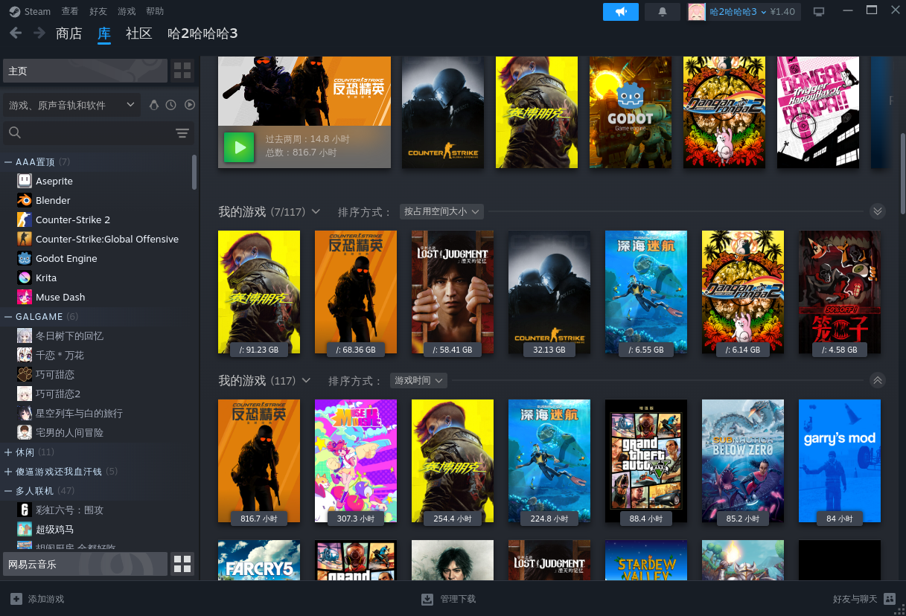
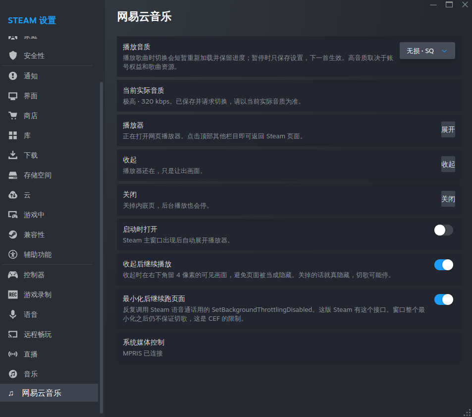
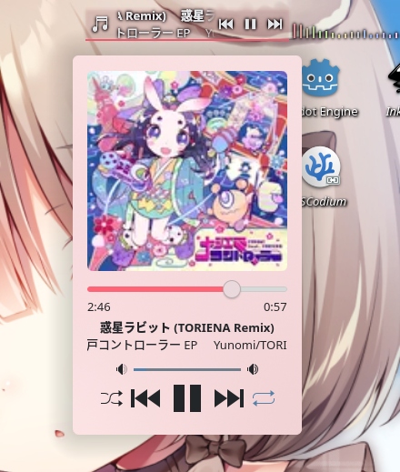

# NEMuxicOnSteam

这是一个 [Millennium](https://github.com/SteamClientHomebrew/Millennium) 插件，可以让你的Steam运行 网易云Web版

> 注意! 使用的是官网那个页面，不是重写的客户端：`https://music.163.com/st/webplayer`

把网易云官方网页播放器嵌进 **Steam**，就不用再挂一个浏览器和他们的客户端吃爆你内存了

还有，本项目主要面向 Linux 用户，因为 Linux 真的需要

由于我不用 Windows 身边也没有 Windows 设备，对于 Windows 的支持不保证

总之，感谢你喜欢本项目。能贡献代码或想法就是对这个项目最大的支持了（话说这逆天 Vibe 项目真有人维护的了吗？）

# 支持

| 软件       | 版本 |
| :---       | :--- |
| Millennium | v5.6.1 及以上                 |
| Steam      | 1791918634 (正式版 + Beta版)  |

## 操作系统

> 由于Millennium仅支持x86_64版本的Steam，所以不支持arm架构的Steam软件

| 系统    | 可用性                 | 备注及注意事项       |
| :---    | :---                   | :---                 |
| Linux   | 支持                   | 仅测试了Arch+KDE+Niri(DMS)，其他发行版或桌面环境只要不是逆天爆改故意针对的都支持       |
| FreeBSD | 未测试                 | Linux可以的话也许FreeBSD理论也可以                                                     |
| Mac OS  | Millennium没发布       | 我是穷鬼安卓人没钱买苹果测试，但如您看上此项目且愿意长期帮忙测试我会很感谢             |
| Windows | 残废不推荐             | 本项目依赖MPRIS实现大部分功能，由于Windows没有MPRIS所以很多功能对于Windows都是残废或不支持的  |

# 特色功能

在Web版网易云的基础下添加更多的功能

详细介绍可看 [Wiki](https://github.com/TATyKeFei/NEMusicOnSteam/wiki/%E5%8A%9F%E8%83%BD%E4%BB%8B%E7%BB%8D) 中查看，这里写了使用方法啥的

| 支持功能   | 支持状况                                              | 备注   |
| :---       | :---                                                  | :---   |
| MPRIS      | 仅 Linux       | Linux 专属，其他系统无 MPRIS 不支持                   |
| 通知       | 支持           | 支持KDE原生通知、Mako等通知服务; Windows未测试        |
| 一起听     | 支持           | 可以加入/创建一起听房间。无法使用消息和麦克风语音聊天功能 |
| 音质设置   | 支持           | 点击播放栏右侧、音量左边的音质按钮，或在**Steam → 设置 → 网易云音乐**里设置；菜单会分别显示已选档位和当前实际音质，部分档位需要 VIP |
| 后台播放   | 支持           | 依赖Steam的通话api，如果你正在使用通话功能可能导致中断。不过应该没人边打电话边听歌不尊重对方吧?  |
| 下载歌曲   | 支持           | 列表里的歌曲更多菜单里新增了“下载”按钮，在**Steam → 设置 → 网易云音乐**里可以选下载音质和目录，默认路径 `~/Music/网易云音乐` |
| 听歌识曲   | 仅 Linux       | 支持桌面音频、麦克风输入录制                          |
| 歌词       | 仅 Linux       | 依赖 MPRIS 连接，做法见[#歌词](https://github.com/TATyKeFei/NEMusicOnSteam/wiki/%E5%8A%9F%E8%83%BD%E4%BB%8B%E7%BB%8D#%E6%AD%8C%E8%AF%8D)            |
| 全局快捷键 | 仅 Linux       | 依赖 MPRIS 连接，做法见[#全局快捷键](https://github.com/TATyKeFei/NEMusicOnSteam/wiki/%E5%8A%9F%E8%83%BD%E4%BB%8B%E7%BB%8D#%E5%85%A8%E5%B1%80%E5%BF%AB%E6%8D%B7%E9%94%AE)       |
| 多播放后端支持 | 仅 Linux   | 可选 mpv、mpd 作为音频播放器引擎                      |
| 歌曲过渡     | 仅 Linux     | mpv 可选无、自动衔接或 1–12 秒渐变过渡                |
| 提前预载下一首 | 支持       | 网页播放和 mpv 无过渡模式下也可独立启用预载           |
| 界面Ui缩放 | 支持           | 网易云很多样式都是根据固定像素而不是分辨率百分比，导致ui在高分辨率大尺寸的显示器显得很小。缩放可以解决这些问题  |
| 全屏与窗口铺满 | 支持       | 点击搜索框右侧全屏按钮进入桌面全屏；按住 Shift 点击只铺满当前 Steam 窗口，不改变窗口大小。再次点击或按 Esc 退出 |
| UnblockNeteaseMusic | 支持  | 支持下载播放灰色无声源歌曲，在官方无地址或仅有试听时尝试其他音源 |
| Steam叠加页面 | 支持中      | 仅支持X11的游戏/软件，因为sbSteam还不支持Wayland，使用Wayland的游戏打开叠加面板画面会卡死 |
| last.fm    | 后续支持       | 记录听歌统计                                          |
| 手柄控制支持 | 后续支持     | 为一些掌机如 SteamDeck、刷了 Linux 的硬破 Switch 服务，就不用搞得屏幕一堆指纹擦来擦去了   |
| API 接口   | 后续支持       | 其他插件可以使用api控制播放暂停歌曲                   |
| HTTP代理   | 后续考虑支持   | 一些海外华人可能由于回国流量差延迟高导致播放缓存卡顿，用一些回国加速器可能没法正常用Steam，代理可能解决这个痛点       |

## 受到限制无法支持的功能

这些功能如果未来开放或发现有实现方式会支持的

| 内容               | 支持状况          | 备注   |
| :--- | :--- | :--- |
| Steam大屏幕模式支持           | 不支持 | 不清楚millennium的原因还是什么，没法在大屏幕模式中注入任何控件           |
| Steam好友状态显示当前播放歌曲 | 不支持 | 目前发现Steam有残留文本代码显示听的原声集但未使用，怕封号风险也不敢做。如果用添加非Steam程序的思路我怕有人故意骚扰好友       |
| 桌面歌词                      | 不支持 | 虽然但是更建议使用当前桌面环境下的歌词小部件。由于 Steam 还在使用 X11，在 Wayland 上会可能有一些问题。等 Steam 支持 Wayland 再考虑 |

# 预览

<p align="center">
  
  <br>
  <sub>主界面，从库左下角的网易云音乐入口进入</sub>
</p>

<p align="center">
  
  <br>
  <sub>设置界面(施工中，图片里全是工地)</sub>
</p>

<p align="center">
  
  <br>
  <sub>MPRIS支持; 此图片中展示用的KDE部件为<a herf=https://github.com/ccatterina/plasmusic-toolbar>PlsaMusic Toolbar</a></sub>
</p>

<p align="center">
  
  <br>
  <sub>切换、下一首歌曲弹窗通知支持</sub>
</p>

# 怎么用?

装好并启用之后，在 Steam 库左下角点击 **网易云音乐** 即可打开

入口右侧的四方格按钮可展开菜单，点击 **设置** 进入网易云音乐设置页，点击 **关闭** 停止播放并关闭播放器。

第一次打开会让你扫码登录一下，之后都不会弹登录了

# 安装教程

详细介绍可看 [Wiki](https://github.com/TATyKeFei/NEMusicOnSteam/wiki/%E5%AE%89%E8%A3%85%E6%95%99%E7%A8%8B)

# 构建

> 需要 Nodejs 22及以上 版本

```bash
npm install
npm run check      # 类型检查 + Node/Python/Lua 测试，需要 python3 和 Lua 5.4
npm run build      # 测试开发时: npm run dev 

npm run build -- --no-install   # 只打包、不复制到millennium插件目录
```

插件构建产物在 `dist/<name>-<version>.star`

其他文件都是构建过程的中间文件、许可证好方便分发，插件本体已经包含了

构建成功后，如果 `~/.local/share/millennium/plugins/` 目录存在，会自动把插件复制过去；目录不存在则跳过，不会创建目录

不建议把 `millennium.toml` 里的 `output_path` 改成 `auto` 构建，因为不好用

[构建脚本](scripts/build.mjs)会统一生成带名称和版本号的安装包，并按目录是否存在决定是否复制

# 已知限制

- 插件创建 BrowserView 时关了 `bOnlyAllowTrustedPopups`，否则 Steam 打开网易云等第三方网站会弹允许非信任弹窗
- 播放器页面使用 Steam 的 BrowserView 承载网页；Steam 本身没有供插件注册独立主窗口路由的稳定接口
- Steam 更新可能改掉 `BrowserView` 或主窗口名字 `SP Desktop`可能导致打不开，需要时间适配
- MPRIS 通过 DevTools 在网易云页面读取状态并调用现有播放器动作，依赖网页的 React/Redux 结构；网易云音乐Web版改版可能需要时间更新适配
- mpv 后端依赖本机安装 `mpv`，启动时会避开 Steam Runtime 的动态库环境；目前由网易云网页提供歌曲地址和播放列表，网页登录失效或网易云改版时，mpv 也无法继续解析新歌曲
- mpv 的“过渡模式”位于“播放后端”下方，可选无（默认）、自动衔接或渐变过渡。自动衔接时才显示“歌曲衔接”的保守、标准和积极档位，淡化上限分别为 3、3.6、5 秒；渐变过渡则单独设置 1–12 秒（默认 4 秒），让上一首淡出、下一首淡入，歌曲较短时缩短淡化窗口。两种过渡都需要 `ffmpeg`（Arch：`sudo pacman -S mpv ffmpeg`），在同一条 mpv 输出流内混合，跳过下一首最多 2 秒的近乎静音开头。暂停和拖动进度仍可用，歌词跟随已播放的下一首进度
- “提前预载下一首”默认关闭，可在网页播放和 mpv 无过渡模式下独立开启，通常在歌曲剩余 45 秒时开始。网页使用网易云当前播放音质，提前缓冲音频并缓存下一首的 URL 响应；浏览器决定实际媒体缓存量。mpv 需要 `ffmpeg`，提前解码到有限 PCM 缓冲，完整播完当前歌曲后再从下一首开头播放，不混音或跳过静音。自动衔接和渐变过渡始终预载下一首；长渐变在高倍速下会更早开始准备
- 过渡和预载只用于顺序播放和列表循环；随机、单曲循环、FM、一起听及试听片段保持普通切歌。下一首解析或解码失败时继续当前曲，播完再按普通方式切歌。关闭预载、改队列、切换网页音质或拖回歌曲前段会清理网页预载缓存。此功能采用非 AI 的能量检测与淡化，不包含节拍补齐、BPM 对齐或生成音乐
- 远程 MPD 必须能直接访问音频地址；需要特定 Referer 的部分解灰音源可能被拒绝。MPD 密码保存在本机插件设置中，采用 MPD 自身的认证协议
- 后台播放依赖 Steam 的通话功能，会调用`SteamClient.Browser.SetBackgroundThrottlingDisabled(true)`函数。如果正在通话时暂停播放音乐可能导致通话出问题

# 项目声明

- 不确保能一直使用，可能因为Steam更新、网易云音乐Web版下架、某个功能停用等不可预因素停止更新某个功能
- 非任何官方插件! 本项目与网易、Valve 都没关系。我要有关系我还在这写这个sb项目早躺平了
- 登录态在 Steam 自带的浏览器里，和系统其他浏览器不共享
- 不会窃取任何数据，程序就开源在这了，不放心就自己构建插件
- 不承担封号风险: 如果被封号建议去测丁磊老冯
- 本项目Ai生成: 这个项目是我指挥Ai写的并审查，反正这个项目也不大就内嵌个页面支持点小玩意啥的没啥技术含量。我不会typescript和lua，我臭玩rust和godotscript的

# 使用/参考的项目

本仓库使用了以下项目的代码、参考了他们的实现思路

- [SPlayer-Next](https://github.com/SPlayer-Dev/SPlayer-Next/tree/006c580628e7a006255dd0a1578de0226e9f12a7)：参考预加载、单输出流、能量检测及等功率衔接思路；本项目使用 Python / ffmpeg / mpv 独立实现

非常感谢以下项目，没有他们我要摸打滚爬好久才能做出来，开源万岁!

| 项目 | 链接 | 备注 |
| :--- | :--- | :--- |
| Millennium | [Github仓库](https://github.com/SteamClientHomebrew/Millennium)  | 用于加载本插件                                      |
| MusicFox   | [Github仓库](https://github.com/go-musicfox/go-musicfox)         | 好用的网易云终端工具，本项目的MPIRS功能参考了此项目 |
| Open Orpheus | [Github仓库](https://github.com/YUCLing/open-orpheus)          | 能让Linux运行网易云客户端，听歌识曲功能参考了此项目 |
| NeteaseCloudMusicApiEnhanced | [Github仓库](https://github.com/NeteaseCloudMusicApiEnhanced/api-enhanced) | 听歌识曲api接口功能用了他 |
| Qplayer    | [Github仓库](https://github.com/TIMER-err/qplayer)               | 第三方网易云音乐客户端，一起听参考了他    |
| Splayer-Next | [Github仓库](https://github.com/SPlayer-Dev/SPlayer-Next)      | 第三方网易云音乐客户端，衔接功能参考了他  |
| UnblockNeteaseMusic | [Github仓库](https://github.com/UnblockNeteaseMusic/server) | 支持播放无声源歌曲[上游库和许可证](THIRD_PARTY_NOTICES.md) |

# 为什么有网易云客户端还要去写这个？

如果你去网易云音乐官网下载页面点击Linux下载，你会发现tm居然直接跳转到Web版？

那么多个客户端版本就是不给Linux适配，我天天用Muxicfox按错快捷键没有都不知道有点烦

然后我看到我Steam天天在后台没啥用，想到他能装插件于是就萌生了这种想法让Linux用上网易云

结果搭配 MPRIS 我体验下来确实不错，没想到Web版音质也这么好

反正Stean天天在后台吃内存也是吃白饭，不用白不用
